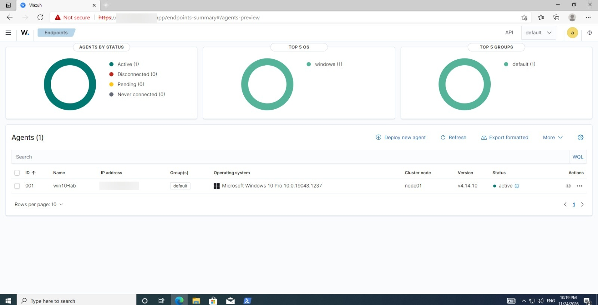
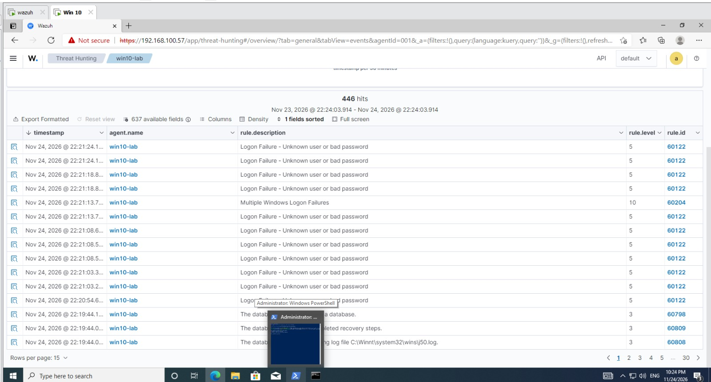
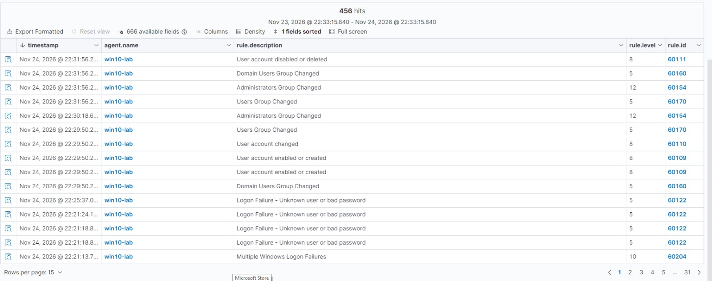
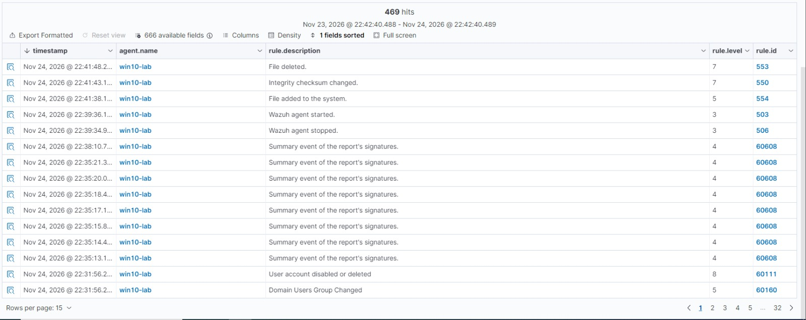

# Wazuh Home SIEM Lab

A small home lab where I set up Wazuh as a SIEM, connected a Windows 10 machine to it, and ran three simple attacks to see if the alerts show up.

## Lab setup

| Part | Details |
|---|---|
| Hypervisor | VMware |
| Wazuh server | Wazuh OVA, version 4.14.10 (manager, indexer and dashboard in one VM) |
| Endpoint | Windows 10 Pro VM, agent name `win10-lab` |
| Agent version | 4.14.10 |
| Network | Both VMs on the same private lab network |

The agent registered with the server and shows as **active**.



## Scenario 1: Failed logins (brute force)

**What I did:** Tried to log in to the Windows machine many times with a wrong password.

**What Wazuh caught:**

- Rule `60122`, level 5: Logon Failure - Unknown user or bad password
- Rule `60204`, level 10: Multiple Windows Logon Failures

The single failures are low level. After several in a row, Wazuh raises the level 10 alert. That is the brute force signal.



## Scenario 2: New admin user

**What I did:** Created a new local user, added it to the Administrators group, then deleted it.

**What Wazuh caught:**

- Rule `60109`, level 8: User account enabled or created
- Rule `60154`, level 12: Administrators Group Changed
- Rule `60111`, level 8: User account disabled or deleted

The level 12 alert for the Administrators group is the one to watch. It is how a privilege escalation or backdoor account would show up.



## Scenario 3: File integrity monitoring (FIM)

**Config:** On the Windows agent I added this line inside the first `<directories>` block of the `<syscheck>` section in `C:\Program Files (x86)\ossec-agent\ossec.conf`:

```xml
<directories check_all="yes" realtime="yes">C:\LabTest</directories>
```

Then restarted the agent:

```powershell
Restart-Service -Name wazuh
```

**What I did:** Created a file in `C:\LabTest`, changed it, then deleted it.

```powershell
echo test > C:\LabTest\a.txt; Start-Sleep 5; echo changed >> C:\LabTest\a.txt; Start-Sleep 5; del C:\LabTest\a.txt
```

**What Wazuh caught, in order:**

- Rule `554`, level 5: File added to the system
- Rule `550`, level 7: Integrity checksum changed
- Rule `553`, level 7: File deleted

The restart is also visible (rules `506` agent stopped and `503` agent started).



## Results

| Scenario | Rules | Detected |
|---|---|---|
| Failed logins | 60122, 60204 | Yes |
| New admin user | 60109, 60154, 60111 | Yes |
| File changes in C:\LabTest | 554, 550, 553 | Yes |

## What I learned

- Wazuh detects Windows events out of the box, but FIM needs a directory added to the agent config.
- The agent must be restarted after editing `ossec.conf`. My first file test ran before the restart and produced no alerts.
- Rule levels help with triage: repeated failed logins reach level 10 and admin group changes reach level 12.

## Next steps

- Add active response to block an IP after repeated failed logins.
- Add a Linux agent.
- Try more attacks, such as PowerShell abuse and new scheduled tasks.
